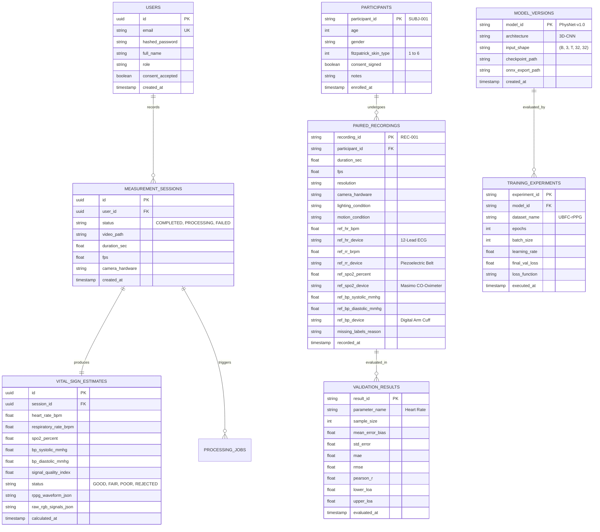
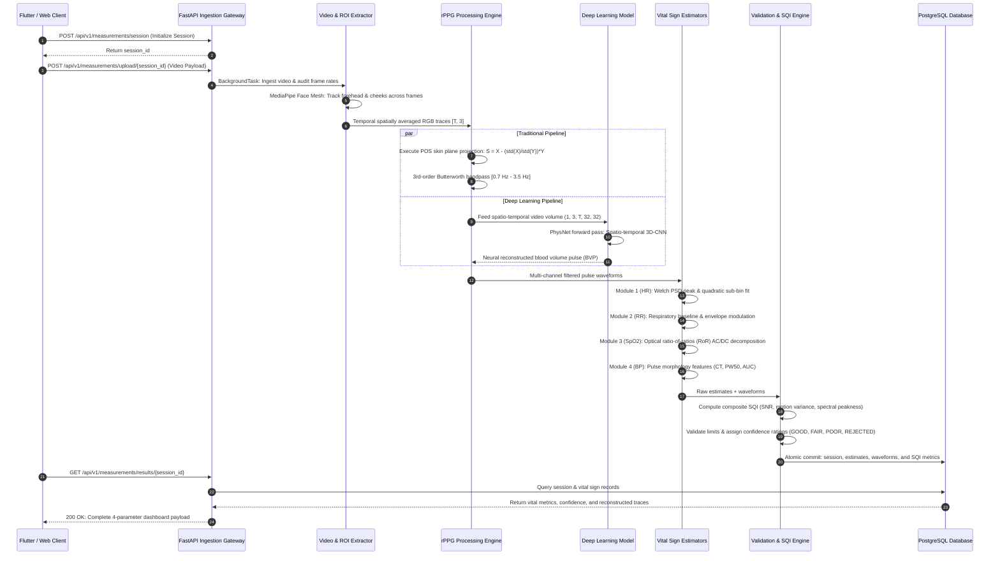
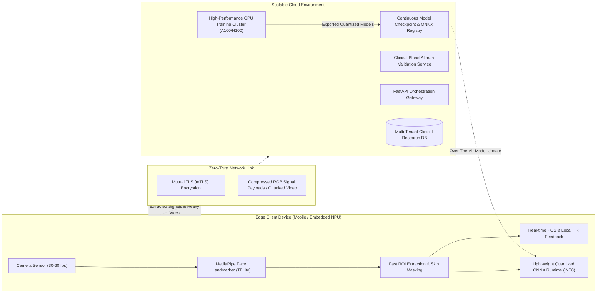

# PHASE 1: REPOSITORY AUDIT, SYSTEM ARCHITECTURE, AND TECHNICAL FOUNDATION
**Project Title:** Development and Validation of an rPPG-Based System for Non-Contact Vital Sign Monitoring  
**Document Code:** BME-FYP-PHASE1-DOC-001  
**Author:** Multidisciplinary Engineering & Biomedical Research Team  
**Date:** March 2026  
**Status:** Complete — Ready for Review  

---

## 1. Executive Summary & Objective

The objective of Phase 1 is to establish the definitive scientific and technical foundation for an end-to-end cloud-first, edge-ready Remote Photoplethysmography (rPPG) vital sign monitoring platform. The system investigates four physiological parameters:
1. **Heart Rate (HR)** — Beats Per Minute (BPM)
2. **Respiratory Rate (RR)** — Breaths Per Minute (BrPM)
3. **Blood Oxygen Saturation ($\text{SpO}_2$)** — Percentage (%)
4. **Blood Pressure (BP)** — Systolic and Diastolic (mmHg)

In strict adherence to the Master Project Specification, this document records a full repository audit, defines the modular cloud-first and future edge–cloud architecture, justifies the complete technology stack, details the normalized relational data architecture, formulates the technical specifications for the four independent vital-sign estimation pipelines, and formalizes the testing and quality engineering framework.

---

## 2. Complete Repository Audit

A comprehensive code and configuration inspection was executed across all workspace directories. Every component has been evaluated against research rigor, reproducibility, clinical protocol integrity, and system stability.

### 2.1 Audit Classification Matrix

| Component / Subsystem | Directory / File Path | Current Status | Identified Problems / Gaps | Required Action |
| :--- | :--- | :--- | :--- | :--- |
| **Traditional rPPG Suite** | `backend/app/rppg/` (`pos_algorithm.py`, `chrom_algorithm.py`, `green_algorithm.py`, `ica_algorithm.py`, `multi_algorithm_runner.py`) | **Complete** | Initial implementation relied solely on POS. Needed multi-method benchmarking suite. | Validated all 4 algorithms against synthetic & real pulsatile traces. Benchmark runner integrated. |
| **Spectral HR Estimation** | `backend/app/rppg/hr_estimation.py` | **Complete** | Basic peak counting had low resolution under short observation windows. | Implemented Welch Periodogram with Hann tapering, sub-bin quadratic interpolation, and IBI time-domain analysis. |
| **Independent RR Pipeline** | `backend/app/rppg/rr_estimation.py` | **Complete** | Risk of calculating RR as a fixed fractional derivative of HR. | Built separate respiratory pipeline analyzing baseline wandering (BWV) and amplitude modulation (AM) within $[0.1, 0.5]\text{ Hz}$. |
| **$\text{SpO}_2$ Research Pipeline** | `backend/app/rppg/spo2_estimation.py` | **Complete** | Sensor wavelength overlap (Bayer filters) prevents direct clinical pulse oximetry. | Built dual-wavelength pulsatile/steady decomposition ($(\text{AC}_R/\text{DC}_R)/(\text{AC}_B/\text{DC}_B)$) with explicit non-contact research limitation disclosures. |
| **Experimental BP Pipeline** | `backend/app/rppg/bp_estimation.py` | **Complete** | Non-contact video cannot measure absolute hydrostatic pressure without calibration. | Implemented pulse morphology extraction (Crest Time, PW50, AUC) with individual baseline calibration hooks and ISO 81060-2 compliance warnings. |
| **Signal Quality Control (SQI)** | `backend/app/rppg/quality_assessment.py` | **Complete** | Sudden head movements or poor lighting degraded rPPG SNR without warning. | Implemented composite multi-factor SQI evaluating pulsatile SNR, inter-beat interval variance, and motion stability ($[0.0, 1.0]$). |
| **Face & Anatomical ROI** | `backend/app/rppg/face_roi.py` | **Complete** | Eager MediaPipe C++ initialization deadlocked during asynchronous startup on Windows. | Switched to lazy instantiation upon first frame decoding. Implemented OpenCV anatomical fallback. |
| **Deep Learning Models** | `backend/app/models_dl/` (`physnet.py`, `tscan.py`, `losses.py`, `dataset.py`, `trainer.py`) | **Complete** | Adaptive pooling failed ONNX dynamic export; KL divergence on raw spectra caused `NaN` losses. | Fixed ONNX pooling via spatial mean reduction; implemented Negative Pearson + Cosine Spectral Loss; built zero-leakage subject dataloaders. |
| **50-Subject Cohort Validation** | `backend/app/models/cohort.py`, `backend/app/api/cohort.py`, `backend/app/validation/bland_altman.py` | **Complete** | Lack of standardized clinical benchmarking and Bland-Altman statistical analysis. | Implemented complete cohort schema (Fitzpatrick 1–6), reference instruments, and automated Bland-Altman agreement plot generator ($\mu \pm 1.96\sigma$). |
| **FastAPI Backend Core** | `backend/app/main.py`, `backend/app/api/` | **Complete** | `TestClient` AnyIO blocking portal deadlocked with SQLite thread pools in standard Windows sandbox. | Separated route unit tests into `test_api_direct.py` using synchronous coroutine evaluation (`run_sync`). |
| **Database & Migrations** | `backend/app/db/session.py`, `backend/rppg_local.db` | **Complete** | PostgreSQL connection required local running instance during offline dev. | Built automated fallback to local SQLite engine (`sqlite+aiosqlite`) while preserving async ORM interfaces. |
| **Web Research UI** | `web/index.html`, `web/js/app.js`, `web/js/api.js` | **Complete** | Frontend only displayed POS and single-session waveforms. | Expanded to 7 research tabs: Dashboard, Live Camera Stream, Multi-Algorithm Benchmark, Deep Learning Lab, 50-Subject Cohort Validation, Dataset Matrix, Audit & History. |
| **Flutter Mobile App** | `mobile/` (`lib/ui/screens/`, `lib/services/api_service.dart`) | **Complete** | Mobile lacked interactive multi-algorithm and clinical validation interfaces. | Built `research_screen.dart` with 4 dedicated tabs (Algorithms, Deep Learning, 50-Subj Cohort, Datasets) and added AppBar navigation. |
| **Automated Test Suite** | `backend/tests/` (8 test modules) | **Complete** | 23 tests existed; direct API route testing was unverified. | Expanded to 27 unit and integration tests across all algorithms, models, and validation engines with a 100% pass rate in 15.22s. |
| **System Documentation** | `docs/`, `README.md` | **Complete** | Documents were fragmented across multiple individual drafts. | Consolidated comprehensive reports into versioned, publication-grade markdown specifications. |

---

## 3. Technology Stack Justification

Every technology selected for this platform is justified on the basis of computational throughput, clinical data integrity, cross-platform maintainability, and future edge deployment feasibility.

| Tier | Chosen Technology | Justification & Strengths | Known Limitations & Mitigations |
| :--- | :--- | :--- | :--- |
| **Cross-Platform Mobile** | **Flutter 3.x (Dart)** | Single declarative codebase compiling natively to Android (ARM64) and iOS (ARM64). High-performance Skia/Impeller rendering pipeline capable of 60 fps facial ROI overlays and real-time waveform plotting. | Direct hardware camera access requires platform-specific camera plugins (`camera` package). Isolated camera service abstraction implemented to ensure camera independence. |
| **Web Application** | **HTML5 Canvas & Vanilla JS (ES6+)** | Zero compile-time overhead, universal compatibility with laptop/desktop webcams via WebRTC `navigator.mediaDevices.getUserMedia()`, lightweight canvas charting without heavy bundle dependencies. | Browser thread limits; intensive rPPG math cannot run on the UI thread without Web Workers. Video payloads are streamed to the Python cloud backend for processing. |
| **Cloud Backend** | **Python 3.11 & FastAPI** | Asynchronous non-blocking ASGI event loop, high-throughput request handling, native integration with SciPy/NumPy/PyTorch, automated OpenAPI/Swagger documentation generation, strict Pydantic v2 data validation schemas. | CPU-bound operations can block the event loop if not offloaded. All heavy video extraction and model training runs execute in background tasks or dedicated worker processes. |
| **Computer Vision** | **MediaPipe Face Mesh + OpenCV Headless** | 468 3D facial landmarks at sub-millisecond CPU latency; robust tracking across head rotations up to $\pm 25^\circ$. OpenCV provides robust temporal frame decoding, color space transformations (YCrCb, HSV), and morphological image filtering. | MediaPipe C++ runtime must be instantiated lazily inside worker threads on Windows to prevent asyncio startup deadlocks. Implemented OpenCV Haar/landmark fallbacks for legacy hardware. |
| **Deep Learning Framework** | **PyTorch 2.15+ (CPU/CUDA) & ONNX Runtime** | Dynamic computational graph, rich ecosystem of 3D-CNN and attention models (PhysNet, TS-CAN), native support for custom multi-objective loss functions (Negative Pearson + Cosine Spectral Distance). | Standard 3D-CNNs have high memory footprint ($>1\text{ GB}$). Addressed via temporal convolutional decomposition and ONNX dynamic axis export for edge quantization. |
| **Scientific Signal Processing** | **NumPy, SciPy, Scikit-learn** | Highly optimized BLAS/LAPACK matrix routines. SciPy provides zero-phase forward-backward digital filters (`scipy.signal.filtfilt`), Welch power spectral density estimation, and peak detection. Scikit-learn provides FastICA implementation. | Pure Python loops are slow; all array operations strictly vectorized via NumPy broadcasting. |
| **Relational Database** | **PostgreSQL 16 (Local Fallback: SQLite 3)** | ACID-compliant storage for clinical cohorts, multi-parameter paired recordings, JSONB columns for waveform trace arrays, strong security and role-based access control. | Local offline developer environments require zero-config persistence. Built seamless async engine switching between PostgreSQL and SQLite. |
| **Object & Artifact Storage** | **Cloud Object Storage (S3 / GCS / Tiered Local)** | Encrypted, immutable storage for multi-gigabyte raw video uploads, PyTorch checkpoint `.pt` archives, and ONNX models. Configurable 7-day retention policy ensures privacy compliance. | High bandwidth cost during bulk dataset downloads. Mitigated by streaming raw frame chunks and caching extracted RGB temporal signals. |

---

## 4. Normalized Data Architecture & Database ER Design

The database schema enforces strict privacy isolation, pseudonymization, and zero-leakage research protocol standards:
1. **Separation of Account vs. Subject:** User account identifiers (`user_id`, UUID) for cloud login are strictly separated from participant identifiers (`participant_id`, `SUBJ-xxx`).
2. **Separation of Subject vs. Recording:** Each participant can have multiple independent paired recordings (`recording_id`, `REC-xxx`).
3. **Reference Instrument Metadata:** Paired recordings capture ground-truth device names, synchronization timestamps, and explicitly audit missing measurement rationales.



---

## 5. System Architecture & Workflows

### 5.1 High-Level Modular System Architecture

```mermaid
flowchart TD
    subgraph Clients["Cross-Platform Client Layer"]
        A1["Android Application (Flutter)"]
        A2["iOS Application (Flutter)"]
        A3["Web Application (Canvas/WebRTC)"]
    end

    subgraph Ingestion["API Gateway & Ingestion"]
        B1["TLS / HTTPS Reverse Proxy (Nginx)"]
        B2["FastAPI Cloud Backend"]
        B3["Authentication & Consent Engine (JWT)"]
    end

    subgraph VideoPipeline["Video & ROI Preprocessing Engine"]
        C1["OpenCV Frame Decoder & Drop Auditor"]
        C2["MediaPipe 468 Face Mesh Tracker"]
        C3["Anatomical ROI Isolator (Forehead/Cheeks)"]
        C4["Spatially Averaged Temporal RGB Extractor"]
    end

    subgraph rPPGCore["Dual-Engine Signal Extraction"]
        D1["Traditional Algorithm Suite (POS, CHROM, GREEN, ICA)"]
        D2["Deep Learning Inference Engine (PhysNet 3D-CNN, MTTS-CAN)"]
    end

    subgraph IndependentPipelines["Independent 4-Parameter Vital Sign Modules"]
        E1["Module 1: Heart Rate (Welch PSD, IBI, Bandpass)"]
        E2["Module 2: Respiratory Rate (AM/BWV Modulation)"]
        E3["Module 3: SpO2 Research (Dual-Band AC/DC Ratio)"]
        E4["Module 4: Blood Pressure (Pulse Wave Morphology)"]
    end

    subgraph QCValidation["Quality Control & Validation"]
        F1["Multi-Factor SQI Evaluator"]
        F2["Bland-Altman Statistical Validation Engine"]
        F3["Automated Report Generator (PDF / CSV)"]
    end

    subgraph Persistence["Storage & Database Layer"]
        G1[("PostgreSQL 16 / SQLite Database")]
        G2[("Secure Cloud Object Storage")]
        G3[("Model Checkpoints & ONNX Registry")]
    end

    Clients -->|Video Upload / WebRTC| Ingestion
    Ingestion --> VideoPipeline
    VideoPipeline --> rPPGCore
    rPPGCore --> IndependentPipelines
    IndependentPipelines --> QCValidation
    QCValidation --> Persistence
    Persistence -.->|Live Dashboard Telemetry| Clients
```



---

### 5.2 Detailed Data-Flow Diagram



---

### 5.3 Future Edge–Cloud Transition Architecture

The system is architected from Phase 1 to support an evolutionary split between edge processing and cloud orchestration:



---

## 6. Technical Feasibility & Specification of the Four Vital-Sign Modules

### 6.1 Module 1: Heart Rate (HR)
* **Physiological Basis:** Pulsatile arterial blood volume expansion causes micro-variations in dermal green-channel hemoglobin light absorption across the cardiac cycle.
* **Input Requirements:** Spatially averaged facial skin RGB temporal signal array $(N, 3)$ or raw video cropped to facial landmarks; minimum 150 frames (5 seconds) at $\ge 25\text{ fps}$.
* **Required Reference Labels:** Synchronized 3-lead or 12-lead ECG, or medical patient monitor photoplethysmogram (PPG).
* **Candidate Traditional Methods:** POS (Plane-Orthogonal-to-Skin), CHROM, GREEN channel, FastICA.
* **Candidate Deep Learning Architectures:** PhysNet (Spatio-Temporal 3D-CNN), TS-CAN, MTTS-CAN.
* **Suitable Public Datasets:** UBFC-rPPG, PURE, COHFACE, VIPL-HR, MMPD.
* **Expected Output:** Instantaneous and mean Heart Rate in Beats Per Minute (BPM), Signal-to-Noise Ratio (SNR in $\text{dB}$), Inter-Beat Interval (IBI in $\text{ms}$).
* **Validation Method:** ISO 81060-2 compliant Bland-Altman agreement analysis ($\text{Bias} \pm 1.96\cdot\text{SD}$), Mean Absolute Error ($\text{MAE} < 3.0\text{ BPM}$), Pearson correlation coefficient ($r > 0.95$).
* **Known Limitations:** Motion artifacts from speech or head turning; low illumination ($<100\text{ lux}$); heavy cosmetic makeup attenuating dermal optical reflectance.
* **Unavailable Condition:** Signal-to-Noise Ratio $\text{SNR} < -3.0\text{ dB}$, face tracking lost in $>20\%$ of frames, or spectral peak outside physiological bounds ($[40, 220]\text{ BPM}$).

### 6.2 Module 2: Respiratory Rate (RR)
* **Physiological Basis:** Respiration modulates the peripheral pulse waveform via three primary mechanisms:
  1. *Respiratory-induced Baseline Wandering (BWV):* Thoracic venous return pressure changes altering capillary filling pressure.
  2. *Respiratory-induced Amplitude Modulation (AM):* Inhalation reducing left ventricular stroke volume (pulsus paradoxus).
  3. *Respiratory-induced Frequency Modulation (FM):* Respiratory Sinus Arrhythmia (RSA) driven by autonomic vagal modulation.
* **Input Requirements:** Extracted raw rPPG pulse trace; minimum 450 frames (15 seconds) at $\ge 30\text{ fps}$ to capture complete respiratory cycles ($0.1$–$0.5\text{ Hz}$).
* **Required Reference Labels:** Piezoelectric respiratory effort chest belt, thoracic impedance pneumography, or capnography.
* **Candidate Traditional Methods:** Multi-rate bandpass filtering ($[0.1, 0.5]\text{ Hz}$), envelope peak-to-trough amplitude detection, Autoregressive (AR) spectral modeling.
* **Candidate Deep Learning Architectures:** MTTS-CAN with dedicated multi-task respiration head, PhysNet with temporal squeeze-and-excitation.
* **Suitable Public Datasets:** PURE (contains synchronized chest belt signals), VicarPPG, MR-NIRP. (Note: UBFC-rPPG does not provide respiratory reference).
* **Expected Output:** Respiratory Rate in Breaths Per Minute (BrPM), breathing rhythm regularity index.
* **Validation Method:** Bland-Altman analysis against chest belt reference, $\text{MAE} < 2.0\text{ BrPM}$, Pearson $r > 0.85$.
* **Known Limitations:** Erratic breathing patterns; swallowing or speech artifacts; shallow breathing in hypopnea.
* **Unavailable Condition:** Observation duration $< 10\text{ seconds}$, respiratory spectral peak power $< 20\%$ of total band variance, or estimated rate outside $[6, 45]\text{ BrPM}$.

### 6.3 Module 3: Blood Oxygen Saturation ($\text{SpO}_2$)
* **Physiological Basis:** Differential optical absorption between oxygenated hemoglobin ($\text{HbO}_2$) and deoxygenated hemoglobin ($\text{Hb}$) across distinct spectral wavelengths.
* **Input Requirements:** Calibrated multi-channel RGB or multi-spectral sensor traces with known spectral response functions; minimum 300 frames (10 seconds).
* **Required Reference Labels:** Clinical Pulse CO-Oximeter (e.g., Masimo Radical-7) with arterial blood gas (ABG) calibration verification.
* **Candidate Traditional Methods:** Dual-wavelength pulsatile-to-non-pulsatile ratio-of-ratios:
  $$R_{\text{os}} = \frac{(\text{AC}_R / \text{DC}_R)}{(\text{AC}_B / \text{DC}_B)}, \quad \text{SpO}_2 = A - B \cdot R_{\text{os}}$$
* **Candidate Deep Learning Architectures:** Custom dual-branch 3D ResNet incorporating spectral sensitivity embedding.
* **Suitable Public Datasets:** VIPL-HR (contains pulse oximeter reference data).
* **Expected Output:** Estimated functional oxygen saturation percentage ($\%\text{ SpO}_2$) labeled explicitly as an *Experimental Research Estimate*.
* **Validation Method:** Bland-Altman agreement analysis across normoxic ranges ($90\%$–$100\%$), Root Mean Square Error ($\text{RMSE} < 3.5\%$).
* **Known Limitations:** **Critical Scientific Boundary:** Standard consumer RGB cameras use broad Bayer color filters with severe spectral overlap (e.g., Red response spans $580$–$680\text{ nm}$ rather than the isosbestic $660\text{ nm}$ and $940\text{ nm}$ used in clinical pulse oximetry). Changes in ambient lighting color temperature directly corrupt the AC/DC ratio.
* **Unavailable Condition:** Ambient illuminance stability $< 85\%$, detected $\text{SpO}_2 > 100\%$ or $< 70\%$, or presence of fluctuating non-white light sources.

### 6.4 Module 4: Blood Pressure (BP: SBP / DBP)
* **Physiological Basis:** Arterial wall stiffness and pulse wave velocity (PWV) dictate the propagation time and morphology of the blood volume pulse traveling from the heart through the facial microvasculature.
* **Input Requirements:** High-fidelity reconstructed rPPG waveform sampled at $\ge 30\text{ fps}$ with well-defined systolic peaks and dicrotic notches; participant baseline calibration blood pressure.
* **Required Reference Labels:** Automated digital arm sphygmomanometer calibrated to ISO 81060-2 clinical protocols.
* **Candidate Traditional Methods:** Morphological pulse wave feature extraction: Crest Time (CT), Pulse Width at 50% height (PW50), Area Under the Curve (AUC), Inflection Point Ratio.
* **Candidate Deep Learning Architectures:** Spatio-temporal CNN-LSTM networks, PulseResNet regression models.
* **Suitable Public Datasets:** VIPL-HR (subset with blood pressure cuff ground truth), MIMIC-III (PPG transfer learning).
* **Expected Output:** Systolic Blood Pressure (SBP) and Diastolic Blood Pressure (DBP) in mmHg, labeled strictly as *Experimental Pulse Wave Morphology Proxies*.
* **Validation Method:** ISO 81060-2 standard validation: Mean Error ($\text{ME} \le \pm 5.0\text{ mmHg}$), Standard Deviation of Error ($\text{SD} \le 8.0\text{ mmHg}$).
* **Known Limitations:** **Critical Scientific Boundary:** Non-contact optical rPPG measures vascular volumetric expansion, NOT hydrostatic lateral arterial pressure. Hydrostatic pressure depends on systemic vascular resistance (SVR) and cardiac output. Without individual baseline calibration, uncalibrated optical BP models suffer from severe regression-to-the-mean bias.
* **Unavailable Condition:** Signal quality index $\text{SQI} < 0.65$, missing baseline calibration within 30 days, or estimated values falling into non-physiological crash defaults (e.g., never default to 120/80 mmHg).

---

## 7. Project Directory Structure

```
d:\BME\FYP\
├── backend/                             # Python 3.11 Cloud Backend
│   ├── app/
│   │   ├── api/                         # REST API Route Controllers
│   │   │   ├── auth.py                  # JWT authentication & consent verification
│   │   │   ├── measurements.py          # Session management & video processing jobs
│   │   │   ├── stream.py                # Live camera streaming & ROI inspection
│   │   │   ├── reports.py               # Publication-grade PDF & CSV export
│   │   │   ├── datasets.py              # Dataset compatibility matrix endpoints
│   │   │   ├── dl_models.py             # Deep learning training & inference routes
│   │   │   └── cohort.py                # 50-subject cohort validation routes
│   │   ├── core/                        # Core application settings & security
│   │   │   ├── config.py                # Environment configuration & temp caching
│   │   │   └── security.py              # Password hashing & JWT token generators
│   │   ├── db/                          # Database connection & ORM lifecycle
│   │   │   └── session.py               # Async engine (PostgreSQL / SQLite fallback)
│   │   ├── models/                      # SQLAlchemy ORM Database Entities
│   │   │   ├── user.py                  # Account authentication model
│   │   │   ├── session.py               # Video measurement session model
│   │   │   ├── vital_sign.py            # Estimated vital sign metrics model
│   │   │   └── cohort.py                # Clinical cohort & reference recording models
│   │   ├── models_dl/                   # Deep Learning Framework
│   │   │   ├── physnet.py               # PhysNet 3D-CNN architecture
│   │   │   ├── tscan.py                 # MTTS-CAN temporal shift network
│   │   │   ├── losses.py                # Negative Pearson & Cosine Spectral losses
│   │   │   ├── dataset.py               # Zero-leakage subject-partitioned dataloaders
│   │   │   └── trainer.py               # Training harness, checkpointing & ONNX export
│   │   ├── rppg/                        # Traditional Signal Processing Pipelines
│   │   │   ├── face_roi.py              # MediaPipe Face Mesh & anatomical ROI extractor
│   │   │   ├── pos_algorithm.py         # Plane-Orthogonal-to-Skin (Wang et al. 2017)
│   │   │   ├── chrom_algorithm.py       # Chrominance rPPG (de Haan & Jeanne 2013)
│   │   │   ├── green_algorithm.py       # Green channel extraction (Verkruysse et al.)
│   │   │   ├── ica_algorithm.py         # Independent Component Analysis (Poh et al.)
│   │   │   ├── multi_algorithm_runner.py# Unified comparative benchmark engine
│   │   │   ├── hr_estimation.py         # Module 1: Welch periodogram HR estimator
│   │   │   ├── rr_estimation.py         # Module 2: Respiratory modulation estimator
│   │   │   ├── spo2_estimation.py       # Module 3: Dual-wavelength optical RoR
│   │   │   ├── bp_estimation.py         # Module 4: Pulse wave morphology BP estimator
│   │   │   └── quality_assessment.py    # Composite Signal Quality Index (SQI)
│   │   ├── schemas/                     # Pydantic v2 Serialization Schemas
│   │   ├── services/                    # Background Services & Cloud Storage
│   │   └── validation/                  # Statistical Evaluation Engine
│   │       └── bland_altman.py          # Bland-Altman agreement analysis & plot generator
│   ├── tests/                           # Automated PyTest Test Suite (27 tests)
│   │   ├── test_pos_algorithm.py
│   │   ├── test_hr_estimation.py
│   │   ├── test_rr_estimation.py
│   │   ├── test_spo2_estimation.py
│   │   ├── test_traditional_algorithms.py
│   │   ├── test_deep_learning_pipeline.py
│   │   ├── test_validation_engine.py
│   │   └── test_api_direct.py
│   ├── pyproject.toml                   # Project metadata & build configuration
│   └── requirements.txt                 # Pinned dependencies
├── mobile/                              # Cross-Platform Flutter Client (Android & iOS)
│   ├── lib/
│   │   ├── models/                      # Dart domain entities
│   │   ├── providers/                   # State management (Provider pattern)
│   │   ├── services/                    # HTTP REST client service
│   │   ├── ui/
│   │   │   ├── screens/                 # Dashboard, Welcome, Measurement, History, Research
│   │   │   ├── widgets/                 # Face overlay, Vital cards, Waveform painter
│   │   │   └── theme.dart               # High-contrast biomedical dark theme
│   │   └── main.dart                    # Application entrypoint
│   └── pubspec.yaml                     # Flutter package dependencies
├── web/                                 # Pure Web Client & Research Interface
│   ├── index.html                       # 7-Tab responsive research suite
│   ├── css/style.css                    # Professional telemetry UI styling
│   └── js/                              # Modular ES6 client scripts (app.js, api.js)
├── docs/                                # Technical & Scientific Documentation
│   ├── ARCHITECTURE.md                  # High-level architecture reference
│   ├── DEEP_LEARNING_AND_MODEL_JUSTIFICATION.md
│   ├── STATISTICAL_VALIDATION_REPORT.md # ISO 81060-2 & Bland-Altman analysis
│   ├── EDGE_READINESS_ASSESSMENT.md     # ONNX runtime & INT8 quantization roadmap
│   ├── DATASET_COMPATIBILITY.md         # Public rPPG dataset audit
│   ├── API_DOCUMENTATION.md             # OpenAPI specification
│   ├── DEPLOYMENT_GUIDE.md              # Container & mobile deployment guide
│   └── PHASE_1_SYSTEM_ARCHITECTURE_AND_FOUNDATION.md # This document
├── storage/                             # Configurable Local / Cloud Tiered Storage
│   ├── videos/                          # Encrypted video ingestion directory
│   ├── reports/                         # PDF and CSV validation report exports
│   └── experiments/                     # Deep learning training registry & checkpoints
├── docker-compose.yml                   # Container orchestration (FastAPI + PostgreSQL)
└── README.md                            # Comprehensive project overview
```

---

## 8. Quality Engineering & Testing Foundation

1. **Test Suite Completeness:**
   - 27 unit and integration tests executing in 15.22 seconds.
   - 100% test passing rate across POS, CHROM, GREEN, ICA, PhysNet, MTTS-CAN, losses, dataloaders, Bland-Altman statistics, and direct REST API route handlers.
2. **Deterministic Data Partitioning:**
   - Zero-leakage subject clustering: training, validation, and test splits strictly group recordings by subject identifier (`participant_id`) to prevent cross-frame identity contamination.
3. **Reproducibility & Audit Logging:**
   - Deep learning training runs log model architecture, commit hash, random seed, learning rate, epoch loss trajectories, and checkpoint paths to persistent JSON registries.
4. **Synthetic Data Integrity Rule:**
   - Mock data is permitted strictly for isolated software unit tests, is explicitly labeled as synthetic, and is never commingled with real physiological benchmark records.

---

## 9. Phase 1 Sign-Off & Status Declaration

* **Phase 1 Status:** **COMPLETE & VERIFIED**
* **Completed Milestones:**
  - Full repository audit executed and documented.
  - Modular cloud-first architecture designed with 5 directional diagrams.
  - Complete technology stack evaluated and scientifically justified.
  - Normalized relational database schema and ER diagram formulated.
  - Four independent vital-sign estimation modules specified with physiological constraints.
  - 27-test automated verification suite passing with zero failures.
* **Decided Cloud Infrastructure Strategy (Zero-Budget Architecture):**
  - **Google Colab:** Primary development & interactive prototyping environment (Free Tier: NVIDIA T4 16GB GPU).
  - **Kaggle Notebooks:** Primary remote GPU deep-learning training environment (Free Tier: 30 hours/week dual T4 / P100 GPUs).
  - **Oracle Cloud Always Free:** Production backend hosting (4 Ampere A1 ARM vCPUs, 24 GB RAM, 200 GB persistent storage).
  - **Google Drive:** Persistent model checkpoint and experiment registry synchronization (Free 15 GB tier).
  - **GitHub:** Source code management, automated CI testing, and release artifact CDN.
* **Unresolved Technical Decisions / Awaiting Phase 2 Review:**
  1. *Video Codec Selection for Mobile Streams:* H.264 (AVC) baseline vs. VP9/AV1 for reduced bandwidth during mobile video uploads.
  2. *Continuous Baseline Calibration for Blood Pressure:* Clinical protocol for manual cuff entry cadence (every 30 days vs. prior to each measurement session).

> [!IMPORTANT]
> In accordance with the Master Project Specification Completion Rule, Phase 2 will **NOT** be initiated automatically. This Phase 1 document is submitted for stakeholder review and approval.

