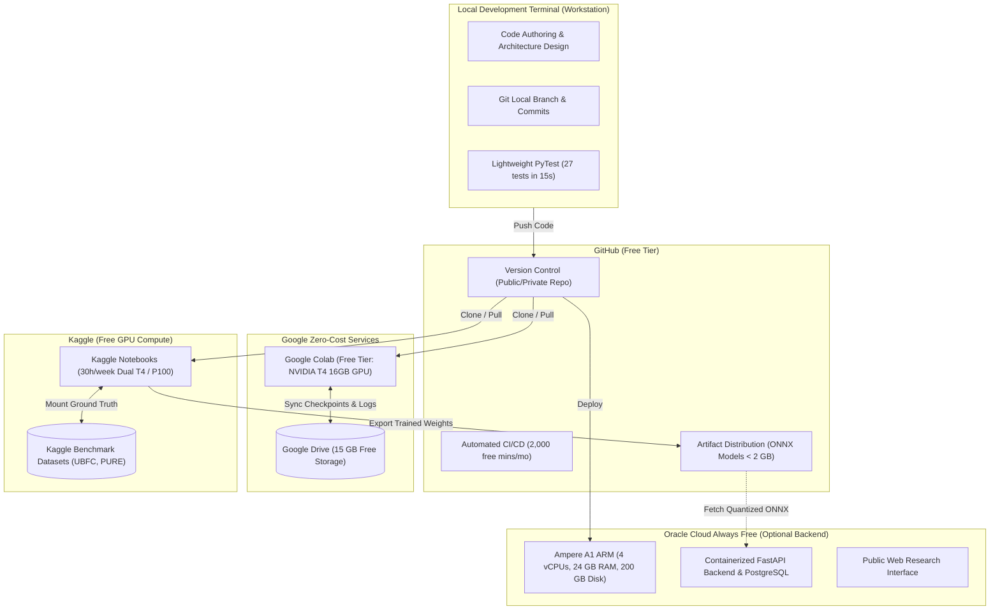
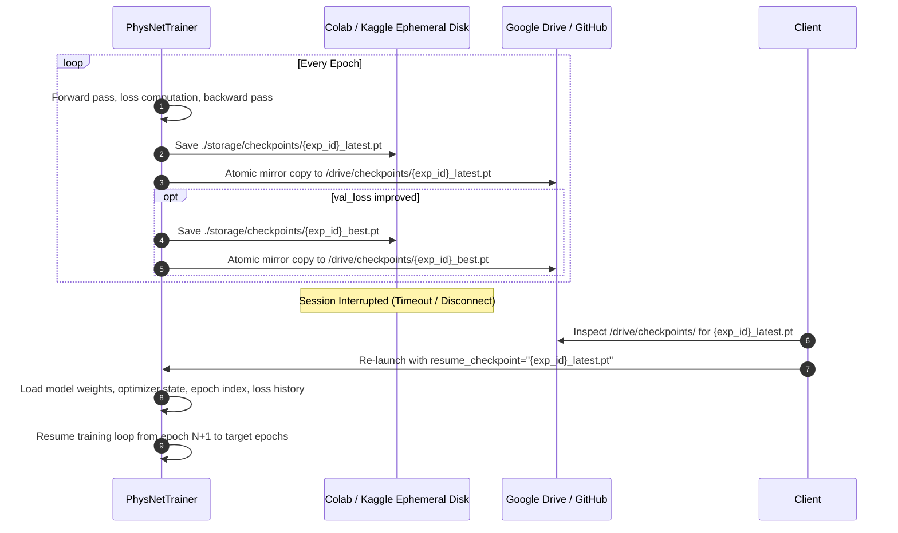

# ZERO-BUDGET CLOUD INFRASTRUCTURE & REMOTE TRAINING STRATEGY
**Project Title:** Development and Validation of an rPPG-Based System for Non-Contact Vital Sign Monitoring  
**Document Code:** BME-FYP-INFRA-001  
**Target Audience:** Biomedical Signal Processing & MLOps Research Team  
**Budget Policy:** Strictly Zero Financial Cost ($0.00) — Always Free Services Only  

---

## 1. Executive Summary & Policy Compliance

This document formalizes the **Zero-Budget Cloud Architecture Strategy** for the research-grade rPPG vital signs monitoring system. In compliance with project requirements:
1. **Zero Financial Budget:** No paid subscriptions, cloud credits, paid instances, auto-renewals, or surprise billing are permitted. All components operate within verified, permanent free allowances.
2. **Zero Local GPU Dependency:** Heavy computation (3D spatio-temporal convolutions, loss backpropagation, hyperparameter sweeps) is strictly offloaded to remote cloud GPU environments. The local workstation functions solely as a development terminal and code orchestration node.
3. **Fault-Tolerant Reliability:** Checkpointing, epoch-level persistence, and automated recovery ensure training runs survive unexpected disconnections, session timeouts, and spot kernel preemptions.
4. **Empirical Research Integrity:** Model evaluation is governed by actual numerical outcomes from genuine training and validation on public benchmark datasets.

---

## 2. Infrastructure Ecosystem Overview



---

## 3. Tier 1: Google Colab (Primary Interactive Development & Experimentation)

Google Colab provides on-demand interactive GPU kernels with zero setup.

### 3.1 Resource Profile
* **Compute:** 1x NVIDIA Tesla T4 (16 GB GDDR6 VRAM) or NVIDIA K80 / P100 depending on spot availability.
* **System RAM:** 12.7 GB (Standard) or up to 25 GB (High-RAM allocation).
* **Cost:** **$0.00 (Free Tier)**.
* **Session Lifespan:** Maximum 12 hours total execution; idle timeout occurs after 30–90 minutes of browser disconnect.

### 3.2 Google Drive Storage Synchronization
Because Colab ephemeral disks are wiped on session termination, Google Drive (15 GB free tier) serves as the persistent checkpoint and experiment registry archive:

```python
# 1. Mount Google Drive
from google.colab import drive
import os
drive.mount('/content/drive')

# 2. Establish persistent project directory
GDRIVE_DIR = '/content/drive/MyDrive/rPPG_Research'
CHECKPOINT_DIR = os.path.join(GDRIVE_DIR, 'checkpoints')
EXPERIMENTS_DIR = os.path.join(GDRIVE_DIR, 'experiments')
os.makedirs(CHECKPOINT_DIR, exist_ok=True)
os.makedirs(EXPERIMENTS_DIR, exist_ok=True)
```

### 3.3 Disconnect Recovery & Checkpoint Resumption
The `PhysNetTrainer` automatically saves two checkpoint files per epoch:
1. `{exp_id}_latest.pt`: Overwritten every epoch to preserve the most recent gradient state.
2. `{exp_id}_best.pt`: Preserved whenever validation loss improves.

When a Colab runtime disconnects, training resumes seamlessly without losing progress:
```python
from app.models_dl.trainer import PhysNetTrainer

# Resume training from the most recent Google Drive checkpoint
trainer = PhysNetTrainer(checkpoint_dir=CHECKPOINT_DIR)
trainer.run_training_experiment(
    num_epochs=30,
    resume_checkpoint=os.path.join(CHECKPOINT_DIR, "EXP-PHYSNET-XXXXX_latest.pt"),
    backup_dir=CHECKPOINT_DIR,
)
```

---

## 4. Tier 2: Kaggle Notebooks (Primary Batch Deep-Learning Training)

Kaggle is the primary engine for multi-epoch training runs, hyperparameter sweeps, and benchmark dataset processing.

### 4.1 Resource Profile
* **Compute:** 2x NVIDIA Tesla T4 (Dual-GPU) or 1x NVIDIA Tesla P100 (16 GB VRAM).
* **Quota:** **30 hours per week of GPU time (100% Free)**.
* **Session Lifespan:** 9 hours for interactive sessions; 12 hours for background "Save & Run All" commits.
* **Disk Space:** 20 GB ephemeral scratch disk (`/kaggle/working`) + 73 GB read-only input mount (`/kaggle/input`).

### 4.2 Dataset Mounting Strategy
Public benchmark datasets (e.g. UBFC-rPPG, PURE) are imported directly from public Kaggle Datasets into `/kaggle/input/` without consuming local bandwidth or personal cloud storage:
* Input: `/kaggle/input/ubfc-rppg-dataset/` (Read-only, zero download delay).
* Working: `/kaggle/working/checkpoints/` (Model outputs, logs, and ONNX exports).

### 4.3 Background Execution ("Save & Run All")
Kaggle allows headless background execution:
1. Push the training notebook to Kaggle.
2. Click **Save Version -> Save & Run All (Commit)**.
3. The training executes on Kaggle's cloud servers even with the user's laptop powered off.
4. Output models and logs are accessible directly in the notebook's output tab or synced to GitHub Releases.

---

## 5. Tier 3: Oracle Cloud Always Free (Optional Backend & API Hosting)

For continuous 24/7 hosting of the FastAPI cloud backend and research web interface without incurring any monthly charge, Oracle Cloud Infrastructure (OCI) provides the most generous Always Free allowance in the cloud industry.

### 5.1 OCI Always Free Specifications
* **Compute:** Arm-based Ampere A1 Compute instances:
  * Up to **4 OCPUs (cores)** and **24 GB of RAM** usable as 1 large VM or up to 4 smaller VMs.
* **Storage:** **200 GB total persistent Block Volume storage**.
* **Networking:** 10 TB per month of free outbound data transfer.
* **Cost:** **$0.00 permanently**. Never expires; no auto-upgrade to paid without manual action.

### 5.2 Deployment Architecture on OCI
```
Internet
  │  (HTTPS Port 443 / HTTP Port 80)
  ▼
[ Nginx Reverse Proxy (Certbot Free Let's Encrypt SSL) ]
  │
  ├──► [ FastAPI Backend (Uvicorn ASGI, Port 8000) ]
  │       ├── Python 3.11 Runtime
  │       ├── MediaPipe Face Mesh & OpenCV Video Decoding
  │       ├── POS, CHROM, GREEN, ICA Signal Processing
  │       └── ONNX Runtime (Quantized INT8 Deep Learning Inference)
  │
  └──► [ PostgreSQL 16 Database (Port 5432) ]
          └── 50-Subject Clinical Cohort & Measurement History
```

---

## 6. Tier 4: GitHub (Version Control, Automated CI, & Artifact CDN)

GitHub anchors reproducibility, automated verification, and model distribution.

### 6.1 Free Tier Capabilities
1. **Source Control:** Unlimited public/private repositories for all code, configurations, and documentation.
2. **GitHub Actions CI/CD:** **2,000 free build minutes per month**.
   - Automatically executes the full 27-test verification suite (`pytest -q backend/tests`) on every pull request and commit.
   - Ensures no regressions in signal processing math or API schemas.
3. **GitHub Releases (Model Distribution):**
   - Free storage and CDN distribution for versioned model checkpoints and exported ONNX artifacts (`< 2 GB` per file limit).
   - The cloud backend and mobile clients download validated ONNX models directly via HTTPS from GitHub Release tags.

---

## 7. Disconnection & Preemption Recovery Playbook

When training deep-learning rPPG models on free-tier cloud platforms, kernel disconnections and preemptions are normal operational events. The following protocol guarantees zero data loss:



---

## 8. Financial Assurance & Expenditure Verification

| Cloud Provider | Service Utilized | Allowed Monthly Cost | Safeguard Against Accidental Billing |
| :--- | :--- | :--- | :--- |
| **Google Colab** | Free Compute Tier | **$0.00** | No payment method required; sessions terminate automatically when free GPU quota is exhausted. |
| **Kaggle** | 30h/week GPU Kernels | **$0.00** | Completely free educational platform; no billing mechanism exists for compute notebooks. |
| **Google Drive** | 15 GB Free Storage | **$0.00** | Standard personal Google account allowance; no credit card required. |
| **GitHub** | Git + Actions + Releases | **$0.00** | Public repository workflows have unlimited free Actions minutes; private repos have 2,000 min cap with hard spending limits at $0.00. |
| **Oracle Cloud** | Always Free Tier | **$0.00** | Explicit "Always Free" resource tags. Set hard billing alert at $0.01 to notify of any non-free tier resource creation. |

---

## 9. Conclusion

The Zero-Budget Cloud Architecture Strategy demonstrates that research-grade deep learning, physiological signal processing, and cross-platform deployment can be achieved with **zero financial outlay ($0.00)**. By coupling Google Colab and Kaggle for remote GPU training with Google Drive persistence, GitHub version control, and Oracle Cloud Always Free hosting, the project maintains strict scientific rigor, zero local hardware strain, and continuous experimental reproducibility.

